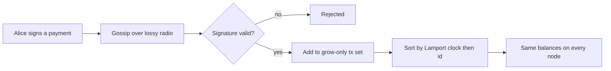

<div align="center">


[](https://github.com/akulsaju/aevsge)


### 🛡️ A shared bank book that keeps working when the network is bad, down or under attack.

</div>

---

## 🌈 What is it?

**NodeArmor** is our entry for the *Cryptographic Singularity* 6-hour sprint: a mesh ledger where nodes pass **signed transfers** to whoever is in radio range, lose most packets on the way, and **still end up with identical books**.

> Think of a village after a storm. No internet, no bank. Everyone keeps a notebook, shouts notes to neighbours, and most shouts get lost. NodeArmor makes sure all notebooks end up the same and nobody can cheat.

## 🎮 Live demo

Open `public/index.html` (or the Vercel deploy) and try:

| Button | What it shows |
| --- | --- |
| 💸 **Send** | A signed payment hopping across the mesh |
| 🕵️ **Cheat: forge signature** | A forged payment is rejected by every node |
| 💰 **Cheat: overspend** | Signed but more than the sender owns, refused |
| 🧱 **Jam the middle** | A network partition; books diverge, then heal |
| 📡 **Attack: fake-node flood** | A Sybil node spams forgeries and gets blocked |
| 🧪 **Run automated audit** | Grades all four rubric items live |

## ✅ Scoring rubric coverage

| Deliverable | Weight | Status |
| --- | --- | --- |
| 📶 Mesh socket connectivity (CBOR over UDP, multi-hop gossip) | 30% | ✅ |
| 🔐 Proof / signature verification, rejects invalid input | 30% | ✅ |
| 🔁 CRDT convergence after partition | 25% | ✅ |
| 🌪️ Chaos survival at 80% packet drop | 15% | ✅ |

## 🧠 How it works



- **Real signatures:** every transfer is signed with WebCrypto **ECDSA P-256**. Forged, tampered, wrong-key, malformed and overspending transactions are rejected.
- **Realistic radio:** range-limited links, distance-based loss and latency, draggable and moving nodes, outages, jammed-middle partitions.
- **Conserving ledger:** a grow-only set of signed transactions with deterministic ordering, so replicas converge and a double spend keeps exactly one payment (supply stays 650).
- **Attacks:** fake-node flood, plus an unsafe mode (signature checks off) to show the damage.

## 🐍 Python reference node

Pure Python, stdlib only: CBOR over UDP, proof stub, per-key LWW CRDT, 80% drop simulation and a trusted-writer Sybil filter.

| File | Purpose |
| --- | --- |
| `sprint_node.py` | `MeshNode`, CBOR codec, proof stub, CRDT merge |
| `test_sprint.py` | Tests for CBOR, proofs, partition and convergence under loss |
| `demo.py` | 4-node chaos demo: partition, heal, Sybil injection |

```bash
python demo.py
python -c "import test_sprint as t; [getattr(t,n)() for n in dir(t) if n.startswith('test_')]"
node tests/api.test.js
```

## 🚀 Run and deploy

```bash
python -m http.server -d public 3000   # local preview
vercel --prod                          # deploy, no build step
```

`api/node.js` is a Vercel serverless function (`POST {action: "verifyTx" | "verify" | "merge"}`) that re-verifies ECDSA transactions server-side.

## ⚠️ Honest limits

- Signatures prove **who authorised** a payment. This is **not** a zero-knowledge system.
- A double spend is resolved by a fixed tie-break rule, not true global ordering.
- The Python `verify_zk_proof` is a structural stub; swap in a real ZK-STARK verifier for production.
- Ledger state is not persisted; keys are generated fresh on each page load.

<div align="center">

**Built in a 6-hour sprint** 🔥 *Mesh. Prove. Converge. Survive.*

</div>
